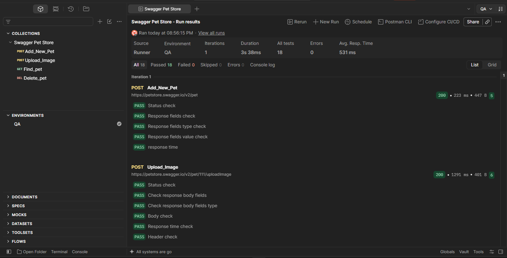
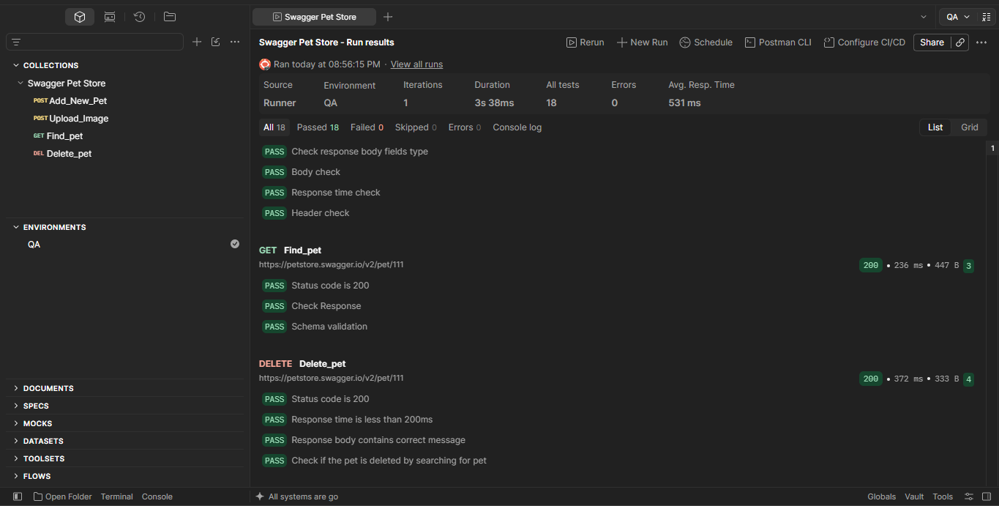

# 🐾 Automated API Testing Suite: Swagger Petstore

This is an automated API integration test suite built in **Postman** using the public Swagger Petstore API. The goal of this project was to simulate a real-world resource lifecycle—handling everything from data creation and file uploads to deep verification and cleanup—without using any hardcoded data.

## 🚀 The Test Workflow
The collection executes the following pipeline automatically:
1. **`POST Add_New_Pet`** - Creates a new pet entry using a JSON payload and securely captures the unique ID generated by the server.
2. **`POST Upload_Image`** - Tests multipart form data by uploading a local image file (`LOGO_1.png`) using the dynamic pet ID in the URL path.
3. **`GET Find_pet`** - Fetches the pet's records and runs a deep structural check to ensure the server's data matches exactly what we originally created.
4. **`DEL Delete_pet`** - Deletes the pet from the system and runs a follow-up test to confirm the resource is completely gone.

## 🛠️ Key Technical Challenges Addressed
* **Dynamic Chaining:** Zero hardcoded IDs. The suite automatically extracts variables from responses using `pm.response.json()` and passes them smoothly to the next request.
* **Multipart Handling:** Used Postman’s internal metadata tools (`.toJSON()`) to extract and validate local uploaded filenames directly from the request body layout.
* **Fixing Integer Overflows:** Bypassed 500 server errors by explicitly casting large 64-bit database integers (`int64`) to strings (`String()`), preventing the data truncation bugs common on this public demo server.
* **JSON Schema Validation:** Implemented structural checks using Chai assertions (`to.have.jsonSchema`) to ensure the entire nested JSON response structure complies with OpenAPI specifications.
* **Performance Check:** Added non-functional benchmark tests to make sure response times consistently meet performance requirements.

## 🏃 How to Run This Project Locally
1. Clone or download this repository to your computer.
2. Open **Postman** and click **Import** in the top-left menu.
3. Choose both files from this project: `Swagger Pet Store.postman_collection.json` and `QA.postman_environment.json`.
4. In the top-right corner of Postman, switch your active environment dropdown to **QA**.
5. Click the three dots `...` next to the collection folder, select **Run Collection**, and hit the run button to watch all 18 test assertions execute!

## 📊 Test Results Dashboard
Here is the execution report showing a 100% success rate across all 18 automated checkpoints:

### Part 1: Adding the Pet & Uploading Media

### Part 2: Verifying Data Stability & Deletion

